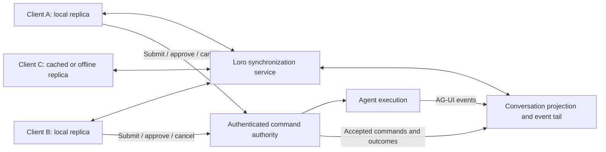

# AG-UI over LoroDoc for distributed, multi-client conversations

Research date: 12 November 2026.

This is a standalone protocol and system-design assessment. It makes no assumptions about the repository containing this file. Findings come from the official AG-UI specification and SDK documentation, Loro documentation, and upstream project sources. Proposed designs and effort assessments below are engineering judgments, not upstream guarantees. No implementation, interoperability experiment, or performance benchmark was performed.

## Assessment

**AG-UI over LoroDoc is feasible. It is particularly useful for conversations that need offline access, reconnect synchronization, shared drafts, annotations, or collaboration on structured artifacts. It is less compelling if the only requirement is broadcasting an agent response to several online clients.**

The strongest design separates three responsibilities:

1. AG-UI describes agent inputs and ordered output events.
2. Loro replicates conversation data and collaborative documents.
3. An execution authority accepts commands and decides which runs, approvals, and tool executions are allowed.

These responsibilities can share infrastructure and connections. They still need separate semantics. A converged document proves that replicas agree on data; it does not prove that an action happened once or that a particular user was authorized to initiate it. Loro explicitly documents this limit for exclusivity, authorization, and cross-replica transactions. [Loro: when not to use CRDTs](https://loro.dev/docs/concepts/when_not_crdt)

| Intended behavior | Feasibility | Convenience and main cost |
| --- | --- | --- |
| Several clients watch one agent run | High | Straightforward; Loro adds infrastructure beyond ordinary event fan-out |
| Reload, reconnect, and read cached history offline | High | A strong fit, provided documents and updates are durably stored |
| Multiple clients submit messages to one conversation | High | Requires admission, ordering, stale-context policy, and deduplication |
| Shared drafts, notes, reactions, editable artifacts | High | A strong use of CRDTs; needs deliberate schema and permissions |
| Multiple agents produce independent runs | High | Separate run streams and explicit conversation/branch relationships |
| Several agents concurrently modify one canonical answer/state | Conditional | Convergence is easy to obtain; meaningful agent behavior is harder |
| Arbitrary existing AG-UI clients connect directly to a Loro room | Requires an adapter | Loro's wire format is not a standard AG-UI binding |
| Safe autonomous execution across disconnected peers | Difficult | Ownership and external effects still need coordination or restricted semantics |

## What “AG-UI over LoroDoc” can mean

### 1. A replicated AG-UI event log

Store immutable AG-UI event records in Loro, then expose them to each client in producer order. This is the most faithful interpretation of carrying the protocol over a document.

AG-UI allows custom transports, but its 1.0 binding contract requires ordered, complete event delivery, delivery of the opening input, identifiable termination/truncation, and an input-rejection path. Document synchronization alone does not implement that contract. [AG-UI transport specification](https://docs.ag-ui.com/spec/1.0/basic/transports/index.md)

An adapter would:

- Associate a stream with its `RunAgentInput` and identity.
- Read immutable event entries, including entries delivered together in one import.
- Deliver each event once to its local reducer, in the producer's sequence.
- Wait for missing entries rather than skip a gap.
- Distinguish a terminal event from a temporarily disconnected producer.

**Advantage:** preserves intermediate events, custom payloads, tool progress, and lifecycle semantics.

**Cost:** token events become durable data; replay, retention, indexing, and stream adaptation remain application work. A CRDT log also does not make sense of competing producers writing incompatible events into the same run.

### 2. A replicated materialized conversation

Consume AG-UI at a gateway and update a Loro document containing messages, text, tool records, run status, and application state. Clients render that document directly.

**Advantage:** convenient for late joiners and offline clients. They obtain the current conversation without replaying every original token event. Loro already supports incremental synchronization using version vectors and tolerates duplicate or reordered CRDT updates once dependencies are available. [Loro synchronization](https://loro.dev/docs/tutorial/sync)

**Cost:** this is an AG-UI-derived data model. The latest document cannot reconstruct every original event or callback. For example, a custom notification that leaves no persistent state disappears unless explicitly retained. One import can also incorporate several changes, so a document subscription is not an original-event subscription. [Loro event handling](https://loro.dev/docs/tutorial/event)

This option is sufficient when the product needs consistent rendering rather than faithful reproduction of an event stream. It needs a custom UI integration or a deliberate snapshot-based adapter for AG-UI consumers.

### 3. A hybrid

Keep a materialized conversation for rendering and recovery, plus an immutable event tail for active runs. Archive completed event logs only when exact replay or auditing is required.

**This is the best starting point for a collaborative conversation product.** It supports fast hydration while retaining the active run's lifecycle and progress. AG-UI itself documents event serialization and compaction into snapshots, so this division has a natural protocol basis. The exact checkpoint format and retention policy are still custom. [AG-UI serialization](https://docs.ag-ui.com/concepts/serialization)

For a reusable transport adapter whose promise is complete event delivery, choose the event-log model first. A hybrid must not silently discard events that its consumers expect to receive.

## Where the protocols fit—and where they do not

### Streaming text fits; concurrent generation into one text does not automatically fit

Appending agent output to a `LoroText` is natural. Collaborative editing can use text operations and stable cursors rather than replace an entire string on each edit. [Loro text](https://loro.dev/docs/tutorial/text)

However, AG-UI text and tool argument deltas concatenate in arrival order, with start/content/end discipline. Mixing two agents' argument fragments can produce invalid JSON even if all replicas converge. Two generated answers can also merge into text that neither agent intended. [AG-UI streaming patterns](https://docs.ag-ui.com/spec/1.0/basic/patterns/streaming)

**Design implication:** give each generated message/tool call one authoritative producer. Put alternative generations in separate messages or branches. Shared human editing should usually affect a draft or editable artifact, with a distinct accepted version used as agent input.

### JSON Patch is not a CRDT operation

AG-UI `STATE_DELTA` is an ordered RFC 6902 patch against a baseline. Patch application must be atomic. Loro transactions bundle operations but do not provide database-style rollback. Applying a patch directly through a series of Loro mutations can therefore leave partial changes if a later operation fails. [AG-UI snapshots and deltas](https://docs.ag-ui.com/spec/1.0/basic/patterns/snapshots), [Loro transaction model](https://loro.dev/docs/concepts/transaction_model)

Example: a producer emits `replace /items/0/title`. A collaborator concurrently inserts another item at the front. The same JSON Pointer can now address a different item. Successful merging does not restore the producer's original intention.

**Design implication:** reduce and validate AG-UI patches against the producer-owned JSON state first, then publish the resulting projection. Use stable object IDs and explicit domain operations for collaboratively edited data. If agents and users edit the same field, specify whether to merge, reject stale changes, or create alternatives. A generic JSON Patch-to-Loro translator cannot choose those product semantics.

### Snapshots need ownership boundaries

`STATE_SNAPSHOT` replaces agent state. It must not accidentally replace unrelated collaborative drafts. `MESSAGES_SNAPSHOT` has its own 1.0 reconciliation rules: it replaces messages by ID, generally drops absent producer-owned material, and preserves existing positions for known messages. It is not a general-purpose CRDT merge or reorder operation. [AG-UI state events](https://docs.ag-ui.com/spec/1.0/events/state)

**Design implication:** separate agent-owned state, accepted transcript, client drafts, and collaborative artifacts. Establish accepted transcript order before emitting messages to generic AG-UI consumers; later snapshot ordering cannot be assumed to rearrange their existing messages.

### Concurrent runs need separate streams or serialization

AG-UI permits several runs sequentially on a stream, but the current run must close before the next opens. It also specifies snapshot restatement for already-held history, because replaying text deltas can append duplicate content. [AG-UI run lifecycle](https://docs.ag-ui.com/spec/1.0/events/lifecycle)

**Design implication:** one conversation document may contain several independent runs, but they must be demultiplexed into separate streams or scheduled into a serial stream. A single list containing arbitrarily interleaved run events is not sufficient. Cross-run transcript order and branch selection belong to the application.

## A practical standalone architecture



The synchronization service and command authority can run in the same process. Neither requires a particular programming language. A command can also be represented as replicated data, but execution must still be authorized and claimed by an authority.

Suggested logical layout—not a standardized AG-UI or Loro schema:

```text
conversation metadata: schema version, conversation ID, generation
accepted message order: stable message IDs
messages by ID: role, run ID, content parts, tool references, delivery status
runs by ID: input/checkpoint reference, producer epoch, status, event sequence
agent state: authoritative JSON projection
active event tail: immutable AG-UI event values with sequence metadata
command outcomes: request ID, acceptance/rejection, resulting run ID

separate writable documents:
  drafts and collaborative artifacts, scoped by their permissions

separate ephemeral channel:
  presence, typing, cursor position, connection hints
```

Use Loro maps/lists/text where their merge behavior is useful. Avoid storing the whole conversation as one JSON-valued map entry: concurrent replacement then chooses a winning value instead of merging independent fields. Loro maps use last-write-wins semantics; independently creating regular child containers at the same key can also hide one child. Initialize shared structure centrally or use mergeable child containers where supported by the chosen bindings. [Loro maps](https://loro.dev/docs/tutorial/map)

Do not use CRDT peer IDs as user identities or execution ownership. They identify editing sessions and operation counters, including across multiple tabs or devices. Let Loro assign them unless there is a specific, correctly persisted reuse scheme. [Loro peer ID management](https://loro.dev/docs/concepts/peerid_management)

### If all interaction must travel through Loro documents

This is possible with per-client or otherwise isolated command inboxes and an authoritative outcome document. Each command carries a stable request ID, its target, and the accepted-context reference it was based on. A worker consumes authorized commands and records outcomes.

This gains offline command submission, but requires command validation, replay protection, durable claims, expiry, and rejection handling. A replicated `claimedBy` field is insufficient: disconnected workers can each act before learning which value wins. A CRDT-only inbox therefore moves the command transport; it does not remove the command authority.

## The main obstacles

### 1. Execution ownership and side effects

If two workers both see an unhandled message and call a model, duplicate generation has already happened before their documents converge. The same applies to sending email, running a shell command, or approving a tool.

Use one active executor per run, with a transactional claim or equivalent coordination. Failover needs fencing so an old executor cannot keep publishing or acting after replacement. Stable command IDs support deduplication, but exactly-once external effects require cooperation from the external service or explicit recovery of uncertain outcomes.

This is the largest obstacle to *distributed execution*. It is much smaller for *distributed observation*, where one producer simply publishes to many replicas. That distinction follows directly from Loro's documented limits on exclusive ownership. [Loro coordination limits](https://loro.dev/docs/concepts/when_not_crdt)

### 2. Context consistency when clients act concurrently

Two users may submit prompts while looking at different conversation versions. Both can be legitimate; accepting both does not explain what the second agent run should read.

Choose a policy: queue against the latest accepted transcript, reject stale submissions, or branch from each submitted context. Record the input actually used for each run. A Loro version vector describes replication progress; it is not automatically a model-context revision or a command ordering decision.

At the AG-UI boundary, construct a valid `RunAgentInput` with the ordered messages and state being shown to the producer. Sending only a Loro document ID is a custom application extension, not a substitute for the standard input contract. [AG-UI run input](https://docs.ag-ui.com/spec/1.0/basic/run-input)

### 3. Tool approvals and frontend tools

Every observer must not execute a tool merely because it sees the same tool event. Assign execution to an authorized participant or backend, and correlate results with the run/tool call. Approval races also need an authoritative decision: a replicated final value cannot undo an action already performed on an earlier approval.

AG-UI 1.0 defines interruptions and answers in a subsequent run's input. The collaboration layer must route the chosen answer and avoid multiple competing resumptions. Notification, viewing, answering, and executing are distinct permissions. [AG-UI interrupts and resume](https://docs.ag-ui.com/spec/1.0/basic/patterns/interrupt-resume.md)

### 4. Permissions at document boundaries

Loro's synchronization protocol supports room-level read/write permissions and forced room eviction. That is useful infrastructure, but it does not express “may edit my draft, may not forge assistant messages.” [Loro wire protocol](https://raw.githubusercontent.com/loro-dev/protocol/main/protocol.md)

Use server-written transcript/run documents that clients read, plus separately authorized writable documents. Alternatively, validate incoming changes before admitting them, which is substantially more complex than ordinary CRDT import. Imported peer IDs and claimed author fields are not authenticated identity.

Confidential data requires separate replication boundaries. A UI hiding a field does not prevent a replica from inspecting its data or retained history. Revoking access prevents future distribution; it cannot erase copies already downloaded.

### 5. Reconnection and faithful event replay

For a log-based adapter, attach by reading a consistent checkpoint and its event cursor, then drain every later event. Avoid the gap between fetching history and installing live observation. Track consumption per logical event sequence; do not treat import callbacks as event IDs.

For an active run, a materialized message alone does not restore open-message/tool tracking in a generic AG-UI reducer. Keep the active run's event prefix, or define an adapter-specific checkpoint that demonstrably restores equivalent protocol state. A missing terminal event means unresolved/truncated observation, not success. [AG-UI transport contract](https://docs.ag-ui.com/spec/1.0/basic/transports/index.md)

Out-of-order Loro imports can remain pending until dependencies arrive. Persist those received bytes too: ordinary snapshots exclude pending imports. This matters when relays or clients crash during catch-up. [Loro import status](https://loro.dev/docs/concepts/import_status)

### 6. Durability, growth, and retention

Loro replication is not durable storage by itself. Store incremental updates and periodic snapshots, define when an accepted operation is durably acknowledged, and recover both integrated state and pending imports. Periodic snapshots alone leave a loss window. [Loro persistence](https://loro.dev/docs/tutorial/persistence)

A persistent token log grows with the entire conversation. Replacing a JSON string on every token also creates repeated values; append text or retain immutable chunks instead. Batch publication to balance latency and work. Do not assume CRDT compression removes the cost of retaining all events or of distributing every byte to every observer.

Shallow snapshots trim old history but limit synchronization with older peers. Define reseeding for clients that return after the retained-history boundary, and a policy for their unsent edits. Removing an event from the visible log is not equivalent to erasing its operation history. [Loro shallow snapshots](https://loro.dev/docs/concepts/shallow_snapshots)

Keep large media in appropriate blob storage with scoped references unless offline replication of those bytes is explicitly required. A large conversation should eventually have archive segments or separate run documents rather than one indefinitely growing active document. This adds indexing and cross-document coordination; Loro's wire specification explicitly leaves collection-level synchronization out of scope. [Loro wire protocol](https://raw.githubusercontent.com/loro-dev/protocol/main/protocol.md)

### 7. Presence and live previews are different from durable output

Loro's `EphemeralStore` is a separate, timestamp-based last-write-wins store with expiring entries. It suits typing, cursor positions, and presence. It should not be the only record of accepted messages, tool outcomes, or terminal run status. [Loro ephemeral store](https://loro.dev/docs/tutorial/ephemeral)

A product may send disposable live previews there and commit the answer later. That reduces durable history, but reconnects and crashes can lose the preview. It also cannot satisfy a promise to deliver every original AG-UI event. Persist periodic progress checkpoints if partial output must survive failure.

## How much is available already?

The building blocks are available; the conversation binding remains custom.

| Building block | Existing support | Remaining integration |
| --- | --- | --- |
| CRDT data types and incremental synchronization | LoroDoc, version vectors, binary updates | Conversation schema and ownership |
| Browser/TypeScript room synchronization | `loro-websocket`, `loro-adaptors` | Authentication, deployment, storage, operational limits |
| Other runtime integration | Rust protocol clients/servers; Python `loro` bindings | Verify transport availability and exact binding feature parity |
| Generic AG-UI event handling | `AbstractAgent` and its reducer/middleware | Loro-backed event source and command mapping |
| Persistent observation | `connectAgent()` / custom `connect()` | Attach, hydrate, demultiplex, resume, detach semantics |
| Safe agent execution | Application infrastructure | Admission, ownership, failover, tool routing, idempotency |

The official Loro protocol repository includes TypeScript packages and Rust implementations, with minimal servers and persistence hooks. Its Node `SimpleServer` is presented for local development/testing; production operation needs its own assessment. Python bindings expose Loro data operations and type stubs, but that is distinct from providing a ready Python implementation of the WebSocket room protocol. [Loro protocol repository](https://raw.githubusercontent.com/loro-dev/protocol/main/README.md), [Loro Python bindings](https://github.com/loro-dev/loro-py)

AG-UI's JavaScript SDK supplies useful extension points: `AbstractAgent.run()` for execution and `connect()` for persistent connections. The latter is unimplemented by default. A Loro-backed adapter can reuse the SDK's event processing, but must define what submitting, attaching, detaching, and cancelling mean across several clients. In particular, closing one observer must not implicitly cancel shared execution. [AG-UI AbstractAgent](https://docs.ag-ui.com/sdk/js/client/abstract-agent)

I did not identify an official AG-UI-over-Loro adapter in the official documentation reviewed or targeted searches. This is a bounded research finding, not proof that no third-party implementation exists. Pin the chosen AG-UI specification and SDK versions before implementation: this report uses the published 1.0 behavioral specification, and older SDK examples may describe different behavior.

## Convenience compared with simpler alternatives

| Requirement | Usually the more convenient starting point |
| --- | --- |
| Online observers only | AG-UI event fan-out over SSE/WebSocket |
| Durable ordered replay only | An event store with cursors and snapshots |
| Offline conversation cache, reconnect merge, shared editing | Loro plus an execution authority |
| Existing AG-UI clients plus custom collaborative clients | AG-UI gateway backed by Loro state/logs |
| Peer-to-peer offline execution | Explicit independent branches and constrained actions; substantially more design work |

Loro becomes convenient when several kinds of shared state would otherwise need their own synchronization protocols. It is less convenient when used solely to reproduce an already ordered, single-writer event stream. In that case it adds CRDT modeling, binary transport, retention, and adapter maintenance without removing execution coordination.

End-to-end encryption is also not automatic. Loro's protocol project has an encrypted extension, but its announcement labels it experimental. A server-side agent that consumes the conversation still needs plaintext access somewhere, and key distribution/revocation remains application work. [Loro protocol announcement](https://loro.dev/blog/loro-protocol)

## Implementation scope and evidence still needed

Relative effort, assuming an existing agent already emits AG-UI:

| Increment | Effort | What makes it complete |
| --- | --- | --- |
| One producer, two live viewers | Low to moderate | Both render the same output; no repeated tool execution |
| Late join and reconnect during a run | Moderate | No missing/duplicated text; lifecycle state remains valid |
| Offline cached history and durable recovery | Moderate | Restart recovery, acknowledged-write policy, retention/reseed behavior |
| Multiple submitting clients | Moderate to high | Accepted ordering, stale-context policy, command deduplication |
| Collaborative editing with access control | High | Shared-field semantics, trust boundaries, rejected-write handling |
| Multiple workers with failover | High | Durable ownership, fencing, and uncertain-effect recovery |

A useful first prototype should demonstrate one authoritative producer, two clients, a deliberately interrupted connection, and a late-joining client during tool execution. Compare its output with the original AG-UI stream, then introduce simultaneous submissions and worker failure. These are proposed validation scenarios; they were not executed for this report.

Measure initial hydration size/time, per-token update overhead, memory and storage growth, reconnect catch-up, observer count, and latency at the chosen batching interval. Include long tool arguments, custom events, multimodal references, and long conversations. No speed, scaling limit, or calendar estimate can be justified from documentation alone.

## Recommendation

**Proceed if the goal includes offline synchronization or collaborative conversation artifacts. Use Loro for replicated data, preserve an ordered AG-UI event path, and give execution an explicit authority.** Start with one authoritative producer per run; allow distribution across independent conversations/runs before attempting competing execution within one run.

For direct AG-UI interoperability, build a custom binding around immutable per-run events and reuse the AG-UI reducer. For clients primarily rendering replicated state, use the hybrid model with materialized messages and an active-run event tail. Keep writable drafts/artifacts separate from the accepted transcript.

The principal hindrance is the gap between document convergence and agent execution semantics: run ownership, context selection, tool authority, snapshot reconciliation, and replay guarantees. Loro addresses the replication portion well. The rest remains a meaningful distributed application design effort.
