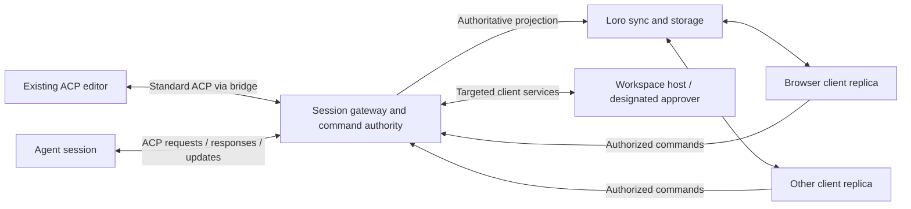

# ACP over LoroDoc for distributed, multi-client conversations

Research date: 12 November 2026.

ACP here means **Agent Client Protocol**, the editor–agent protocol at agentclientprotocol.com. This is a standalone assessment, independent of the repository containing this file. It covers both transporting ACP through Loro documents and using Loro as a replication layer around ACP.

The official documentation currently labels **v1 as latest and v2 as draft**. The primary assessment uses v1; a separate section explains how draft v2 changes the tradeoffs. Proposed architectures and effort ratings are engineering judgments. No implementation, interoperability experiment, or performance benchmark was performed. [ACP protocol documentation](https://agentclientprotocol.com/protocol/v1/overview)

## Assessment

**ACP over LoroDoc is technically feasible, but a complete binding is a substantial integration. Loro is convenient for distributing conversation state, offline history, shared drafts, and collaborative artifacts. It is less convenient as the transport for every live ACP request and response.**

The reason is ACP's bidirectional RPC model. A client sends prompts, but an agent also sends requests back to the client. Those requests can require a permission decision, a file read, or command execution. Distributing the conversation therefore involves more than replicating agent output. [ACP communication model](https://agentclientprotocol.com/protocol/v1/overview)

The strongest general-purpose design is:

1. One execution authority owns each active agent session.
2. ACP handles live interaction with the agent and its client-side services.
3. Loro distributes an authoritative conversation projection and collaborative documents.
4. A policy decides which connected clients may submit, approve, configure, or cancel.

All four can share one service. If every interaction must travel through Loro, the same authority is still needed behind replicated RPC mailboxes.

| Intended behavior | Feasibility | Convenience and principal cost |
| --- | --- | --- |
| Many clients observe one agent session | High | A good replication use case; needs a transcript/state reducer |
| Offline cached history and reconnect synchronization | High | Strong fit, with durable storage and retention policies |
| Multiple clients submit to one session | High with a coordinator | Needs admission, context ordering, and duplicate-submission handling |
| Shared drafts and editable conversation artifacts | High | Natural CRDT use; separate from accepted agent history |
| Transfer control between clients | Feasible | Requires explicit workspace, capability, and pending-request handover |
| Native ACP RPC carried entirely through LoroDoc | Feasible | Custom transport, routing, lifecycle, deduplication, and recovery machinery |
| Existing ACP editors use it without modifications | Via a bridge | The editor needs its usual ACP endpoint; it cannot directly join a Loro room |
| Multiple independent workers execute one session during a partition | Difficult | Convergence does not enforce exclusive execution or prevent duplicate effects |

**Compared with AG-UI:** the extra difficulty is routing live requests to the correct client environment and correlating their responses. A replicated view of a conversation is much easier than a replicated replacement for an entire ACP connection.

## What the specifications permit

ACP uses JSON-RPC requests, responses, and notifications. Its documented standard transport is stdio, and it permits custom transports that preserve JSON-RPC and ACP lifecycle requirements. Consequently, Loro is not prohibited as an underlying channel. [ACP v1 transports](https://agentclientprotocol.com/protocol/v1/transports)

There is also an active proposal for Streamable HTTP and WebSocket transport. That proposal is relevant prior art for connection identity, routing, and reliability, but it is not a finalized Loro binding or a guarantee that arbitrary agents support remote access. [ACP remote transport RFD](https://agentclientprotocol.com/rfds/streamable-http-websocket-transport)

Loro supplies data types, binary updates, version-vector-based synchronization, and convergence after replicas receive the same updates. It does not supply ACP request futures, authorization policy, or a decision about which participant should execute a request. [Loro synchronization](https://loro.dev/docs/tutorial/sync)

The practical distinction is **replicated state versus message delivery**. Two documents reaching the same final JSON is sufficient for many UI needs. It is insufficient for an RPC endpoint that must receive and handle every relevant message exactly once within its live connection.

## Three implementation approaches

### A. Full ACP transport through Loro documents

Each logical ACP connection gets immutable, addressed message records. The binding exposes an ordered incoming stream and outgoing sink to the ACP SDK. Both requests and responses pass through this mechanism.

A connection needs two directional streams, or equivalent routing that keeps the senders distinct. Each stream preserves its sender's order. Different connections remain separate; their raw messages must not be fed indiscriminately into one agent connection.

An illustrative transport record—not an ACP schema extension:

```text
connection generation: conn-27
sender: client-A
recipient: agent-gateway
sequence: 104
payload: UTF-8 JSON for one complete ACP JSON-RPC message
```

The envelope belongs to the Loro transport. The reconstructed ACP message stays intact. Responses use their original JSON-RPC IDs; a gateway that rewrites IDs must maintain the reverse mapping. JSON-RPC responses correlate with the sender's request, while notifications have no response. [JSON-RPC specification](https://www.jsonrpc.org/specification)

Avoid a `latestRequest` field: a disconnected receiver could observe only the newest request and miss earlier ones. Retain separate immutable records until the binding's delivery/retention rules permit removal. Importing a Loro snapshot must wake a reader to drain unseen records; it must not blindly re-execute every request in that snapshot.

**Advantages:** a unified replication substrate; store-and-forward where explicitly allowed; possible reuse of existing ACP RPC dispatchers.

**Costs:** connection generations, per-recipient consumption, ordering, timeout policy, delivery receipts, stale-request rejection, persistence, and cleanup. Reconstructing a document does not reconstruct a process's pending RPC futures. After a restart, the binding must either resume a deliberately persisted logical connection or establish a new one and reconcile outstanding operations.

This approach is most attractive when a product already has Loro networking and specifically needs document-backed message delivery. It is more machinery than a conventional live bidirectional channel.

### B. ACP-to-Loro conversation projection

A gateway communicates normally with the agent, reduces `session/update` notifications and lifecycle outcomes, and publishes messages, tools, plans, and session state into Loro. Clients render local replicas.

**Advantages:** simple observation, fast hydration, offline reading, and convenient integration with collaborative drafts.

**Costs:** this is a custom ACP-derived data model, not a complete ACP transport. A document containing tool status does not answer a live permission request or implement client terminal execution. A projection may also lose transient notices or extension payloads unless it explicitly preserves them.

For v1, the reducer must also observe the `session/prompt` response: that response carries the turn's stop reason. Replicating only `session/update` notifications omits a key completion signal. Message IDs on v1 message chunks are optional, so grouping and replay identity cannot universally depend on them. [ACP v1 prompt turns](https://agentclientprotocol.com/protocol/v1/prompt-turn.md)

### C. Hybrid: live ACP RPC, replicated conversation state

Use direct RPC for prompts, permission responses, and client services; use Loro for the shared transcript, cached history, drafts, and artifacts. Retain a bounded update log when faithful live replay is needed.

**Recommended starting point.** It places CRDTs where concurrent edits and disconnected replicas are useful, while allowing request/response operations to remain explicit. Loro's own guidance recommends an authoritative transaction/command layer where actions require exclusive ownership or validation. [Loro coordination limits](https://loro.dev/docs/concepts/when_not_crdt)

This does not require two physical connections. A service may multiplex channels, but their semantics and permissions should remain distinct.

## The main obstacles

### 1. A session ID is not a multi-client collaboration policy

ACP sessions contain their own conversation context and state. The v1 loading mechanism supports restoring history and sharing sessions between client instances. That does not establish a general policy for simultaneous controllers, shared approvals, or conflicting workspace providers. [ACP v1 session setup](https://agentclientprotocol.com/protocol/v1/session-setup.md)

Choose explicitly among:

- One controller and many observers.
- Several submitting clients, with one authority ordering accepted work.
- Explicit control transfer.
- Independent branches with separate execution contexts.

The first is easiest. Several submitters are practical if the agent or gateway defines whether another prompt queues, is rejected, or steers current work. A CRDT list's eventual order should not retroactively change the order in which the model consumed prompts.

A CRDT `controller = clientA` field is not an exclusive lease. Two disconnected clients can each believe they control the session before their writes merge. Execution claims and control handover need authoritative arbitration and, for worker failover, fencing against the old owner.

### 2. Capabilities belong to actual peers

ACP initialization negotiates version and capabilities before sessions are created. Omitted client capabilities are unsupported. [ACP v1 initialization](https://agentclientprotocol.com/protocol/v1/initialization.md)

Suppose a desktop supports filesystem and terminal calls while a phone only renders messages. Their combined presence does not create one interchangeable client. If a gateway advertises terminal support upstream, it must actually provide or route that service, including when the desktop disconnects.

Maintain per-client capabilities and explicit service ownership. Do not advertise the union of everyone's capabilities unless the gateway can honor that union. A control transfer may need to replace, reject, or preserve the existing service environment rather than merely change a shared field.

### 3. Whose files and processes does the agent use?

In v1, `fs/read_text_file` can read unsaved editor buffers, and `fs/write_text_file` modifies the client's files. These calls therefore carry environment-specific meaning. [ACP filesystem methods](https://agentclientprotocol.com/protocol/v1/file-system.md)

If two clients both have `/project/main.py`, those paths may identify different revisions or machines. Loro synchronizing the conversation does not synchronize their workspaces.

Choose one canonical workspace host, explicit provider routing, or a separately designed collaborative workspace. A diff displayed in a tool call is not itself a distributed file-edit command. Publishing a file snapshot into Loro also does not keep disk files or unsaved buffers synchronized automatically.

Client terminal calls add process ownership. V1 terminals are created in a client's environment and return handles used by later output/wait/kill/release requests. The agent is responsible for releasing them. [ACP terminals](https://agentclientprotocol.com/protocol/v1/terminals.md)

A replicated terminal ID is only a reference: another client does not thereby acquire the process. Route control to its owner, distribute output separately, and decide what happens if that owner disappears. Blindly retrying `terminal/create` can start another process.

### 4. Permission requests must produce one authorized answer

ACP's `session/request_permission` is a request/response exchange. Tool-call notifications describe agent actions; they are not instructions for every observer to execute those actions. [ACP tool calls and permissions](https://agentclientprotocol.com/protocol/v1/tool-calls.md)

An application may show an approval to several people, but it needs one resolution policy: designated approver, first authorized decision, or an explicit quorum. A last-write-wins field cannot safely arbitrate approval: an action may already have run before a later rejection becomes visible.

Represent the pending decision for display, then let an authority validate an answer against the still-open request and forward exactly one response. Reject late decisions from retired connection generations. Apply the same principle to structured questions and other agent-to-client requests.

### 5. Replaying data must not replay actions

Loro can deliver the same underlying updates more than once without duplicating their CRDT effects. That does not make an external request handler idempotent. Calling `session/prompt` twice may insert two user prompts; calling a tool twice may duplicate its side effect.

Separate these identities:

| Identifier | Purpose |
| --- | --- |
| Loro operation/version | Replication progress |
| Connection generation + direction + RPC ID | Correlation for a live RPC exchange |
| Stable application command ID | One user intent across retries/reconnects |
| Session/execution identity | Target and accepted context |

Use durable deduplication for retryable commands. A request with a reused command ID but different content should be rejected. A transport receipt, RPC response, durable save, prompt acceptance, and completed execution are different milestones.

If an agent accepted work but the gateway crashed before recording the answer, the outcome is uncertain. Without an agent-supported idempotency or lookup mechanism, an external gateway cannot guarantee safe transparent retry. Record the uncertainty and reconcile; do not turn a missing response into permission to repeat the action.

### 6. Cancellation is particularly vulnerable to delayed delivery

V1 `session/cancel` identifies the session, not an application-defined turn generation. A cancel created offline for yesterday's work could arrive while today's work is active. The gateway should validate the intended execution before forwarding it, or expire it. That targeting information is a custom command envelope, not an invented standard ACP field.

V1 cancellation also has lifecycle obligations: pending permission requests receive cancelled outcomes, final updates can arrive during cancellation, and the original prompt receives its terminal response. Merely setting `cancelled = true` in a document does not complete this exchange. [ACP prompt cancellation](https://agentclientprotocol.com/protocol/v1/prompt-turn.md#cancellation)

Generic `$/cancel_request` is distinct and does not provide a universal guarantee that underlying activity stops. A binding must preserve pending response handling even when cancellation is requested. [ACP request cancellation](https://agentclientprotocol.com/protocol/v1/cancellation)

### 7. Conversation replay is not RPC replay or execution restoration

Loading history is a display/context-restoration operation. It must not resend old terminal requests, resolve already-closed approvals, or rerun prompt commands. Keep a public conversation projection separate from private live RPC traffic.

A Loro copy of the visible transcript also does not necessarily contain the agent's complete resumable state. An agent may retain provider-specific context, compaction state, tool state, and other internal data. Treat distributing agent execution checkpoints as a separate integration; transcript replication alone cannot promise agent failover.

When serving history and live changes together, define a checkpoint plus update cursor and avoid a gap between snapshotting and subscribing. If the agent reloads history from scratch, use a new projection generation or rebuild against its authoritative replay instead of appending everything to the previous transcript.

### 8. Permissions must follow replication boundaries

Loro's room protocol provides read/write permissions and room eviction. Those permissions do not express field-level rules such as “may add my draft, may not forge tool success.” [Loro wire protocol](https://raw.githubusercontent.com/loro-dev/protocol/main/protocol.md)

Use server-written session projections, private per-connection traffic, and separately writable collaborative documents. If clients directly edit a shared document containing authoritative execution records, either validate changes before admitting them or accept that those records are untrusted proposals.

Loro peer IDs identify editing sessions, not authenticated users or authorization grants. [Loro peer ID management](https://loro.dev/docs/concepts/peerid_management)

Do not replicate raw authentication exchanges, MCP credentials, filesystem responses, or permission traffic to every observer. ACP agent authentication and access to a collaboration room are separate concerns. A shared upstream agent login does not automatically establish per-user session permissions. [ACP authentication](https://agentclientprotocol.com/protocol/v1/authentication.md)

### 9. Persistence, retention, and performance remain application work

Persist updates and checkpoints, and define when a command or output is durably acknowledged. Loro snapshots do not include imports waiting for missing causal dependencies; preserve those bytes separately when they can occur. [Loro persistence](https://loro.dev/docs/tutorial/persistence), [Loro pending imports](https://loro.dev/docs/concepts/import_status)

Token chunks, terminal output, complete file contents, and RPC envelopes can generate substantial history. Batch synchronization without losing logical message order. Keep large blobs outside active conversation documents where possible. Measure both live latency and late-join cost.

Shallow snapshots reduce retained history but introduce a synchronization boundary for old replicas. Returning clients may need reseeding; their unsubmitted drafts need a separate recovery path. Deleting a visible request record does not necessarily erase its historical contents from other replicas. [Loro shallow snapshots](https://loro.dev/docs/concepts/shallow_snapshots)

Use ephemeral state for presence, typing, and cursor hints. Loro's `EphemeralStore` expires entries and is separate from durable documents; it should not be the sole record of accepted prompts, approvals, or execution outcomes. [Loro ephemeral store](https://loro.dev/docs/tutorial/ephemeral)

## A practical architecture



The gateway acts as an ACP client toward the agent and, when supporting existing editors, as an ACP agent toward each editor. That makes it a semantic proxy, not merely a byte broadcaster. It must advertise and implement the capabilities it can provide on each side.

Suggested logical document boundaries:

```text
authoritative session projection, read-only to observers:
  session identity and projection generation
  accepted conversation order and message content
  tool calls, plans, configuration, usage, execution state
  checkpoint and ordered update tail

private connection data:
  negotiated version and capabilities
  directed RPC records and responses
  connection generation, sequence, delivery state

separate collaborative documents:
  per-user drafts, shared notes, editable artifacts

trusted command store:
  request identity, acceptance, execution claim, outcome
```

These are proposed boundaries, not standard ACP objects. Preserve extension payloads and wire distinctions rather than reducing every update to display text. ACP provides `_meta`, custom methods, and capability advertisements for negotiated extensions; custom fields must not be added arbitrarily to standard objects. [ACP extensibility](https://agentclientprotocol.com/protocol/v1/extensibility.md)

Loro maps use last-write-wins resolution for conflicting keys. Model independently editable data as suitable child containers rather than replacing one giant JSON object. Initialize shared structure deliberately; mergeable child containers address concurrent creation at a logical key where the selected binding supports them. [Loro maps](https://loro.dev/docs/tutorial/map)

If all commands must use Loro, replace the diagram's command arrows with private addressed inboxes. Keep the trusted acceptance/claim step. A receiver must distinguish fresh commands from historical records received during synchronization.

## How draft ACP v2 changes the assessment

V2 makes an ACP-to-Loro projection more natural, but is still draft:

| Change | Effect on a Loro integration |
| --- | --- |
| Prompt response acknowledges message insertion; foreground completion uses `state_update` | Separates acceptance from execution state |
| Identified message upserts and chunks; ID-based tool/plan updates | Better correspondence with document entities |
| Client filesystem and terminal execution APIs removed; client tools provided through MCP | Removes those specific reverse-RPC surfaces, but tool ownership/routing remains |

These are version-specific behaviors; v1 endpoints cannot be treated as having them. [ACP v2 migration guide](https://agentclientprotocol.com/protocol/v2/migration)

V2 keys entities by **type and ID**, permits interleaved entity updates, and separates foreground state from background activity. A reducer must honor those semantics rather than infer one global message from chunk arrival. [ACP v2 prompt lifecycle](https://agentclientprotocol.com/protocol/v2/prompt-lifecycle.md)

Important remaining limits: simultaneous activity on multiple connections is agent policy; disconnect may continue or cancel foreground work. `session/resume` can replay retained history and synchronize current state, but most entity IDs are not guaranteed stable across reconnects/restarts. Full replay should rebuild the projection rather than assume ID-based deduplication is sufficient. Pending interactive requests are reestablished or safely resolved, not replayed as historical actions. [ACP v2 session setup](https://agentclientprotocol.com/protocol/v2/session-setup)

V2 explicitly requires transport message order and ordered application of session updates. Its current transport specification prohibits JSON-RPC batches: batching Loro updates must not turn delivered ACP messages into a JSON array. [ACP v2 transports](https://agentclientprotocol.com/protocol/v2/transports)

**Conclusion:** v2 reduces projection friction, especially for messages and lifecycle state. It does not supply a collaborative control policy, a distributed execution lock, or a standard ACP-over-Loro binding. Select one protocol version and pin the matching schema/SDK; supporting both versions is a separate scope choice.

## Available building blocks and convenience

ACP SDKs already provide protocol types and RPC plumbing. The TypeScript SDK exposes readable/writable message streams, so a custom Loro-backed stream can potentially reuse its RPC engine rather than reimplement JSON-RPC. The Python SDK likewise provides models, async interfaces, and RPC plumbing; exact custom-transport hooks should be checked in the selected version. [ACP TypeScript stream source](https://github.com/agentclientprotocol/typescript-sdk/blob/main/src/acp.ts), [ACP Python SDK documentation](https://agentclientprotocol.com/libraries/python)

Loro's protocol project supplies TypeScript synchronization packages, adapters, and Rust implementations, with room multiplexing, fragmentation, and minimal servers. These help move documents; they do not implement ACP routing or its session authority. Its example servers still require a production suitability assessment. [Loro protocol repository](https://raw.githubusercontent.com/loro-dev/protocol/main/README.md)

I did not identify an official ACP-over-Loro binding in the documentation reviewed or targeted searches. That is a bounded research finding, not proof that no implementation exists.

| Requirement | Usually the more convenient starting point |
| --- | --- |
| One remote controlling client | Direct ACP bidirectional transport or stdio bridge |
| Multiple online observers only | Fan-out of a session projection/update stream |
| Offline history plus collaborative drafts/artifacts | ACP gateway with Loro replication |
| Unmodified ACP editors and collaborative custom clients | ACP-facing bridge plus replicated projection |
| Store-and-forward ACP requests | Explicit Loro mailbox binding with expiry and deduplication |
| Disconnected peers independently acting on shared resources | Separate branches/workspaces or an authority that gates effects |

## Scope and validation still needed

| Increment | Relative effort | Main completion criterion |
| --- | --- | --- |
| One agent, two read-only Loro viewers | Moderate | Same transcript, tool state, and lifecycle outcome |
| Late join/reconnect during a prompt | Moderate | No missing or duplicated chunks; coherent completion |
| Multiple submitting clients | Moderate to high | Defined admission order and retry behavior |
| Targeted approvals and workspace services | High | One authorized response/action at the correct owner |
| Complete ACP RPC through LoroDoc | High | Bidirectional ordering, generations, receipts, timeouts, and safe recovery |
| Worker failover with external side effects | High | Fencing, checkpoint integration, and uncertain-effect handling |

A useful prototype should cover:

1. Prompt, streamed response, tool update, and final lifecycle outcome.
2. A second client joining halfway through the response.
3. Disconnect during approval, followed by a stale answer after reconnect.
4. Disconnect after prompt acceptance but before the caller sees its response.
5. A delayed cancellation arriving after another prompt starts.
6. A client-hosted process whose response is lost after creation.
7. Worker restart with old RPC records and new pending requests using reused wire IDs.
8. Full agent history replay into an already-cached projection.

These are proposed validation scenarios, not work performed for this report. Measure hydration time/bytes, live update latency, synchronization/storage growth, replica memory, fan-out, and cleanup behavior. Documentation alone cannot establish scaling limits or a defensible calendar estimate.

## Recommendation

**Use ACP with Loro when replicated conversation state and collaboration are central product requirements. Start with one session authority, a canonical workspace/service environment, and many observers. Add controlled multi-client submission before control transfer or distributed execution.**

For an actual ACP-over-Loro transport, use private immutable directional message records and reuse an ACP SDK's RPC implementation. Define connection generations, ordering, command idempotency, and failure semantics before relying on reconnects. Treat history synchronization as data delivery, never implicit authorization to replay operations.

For most products, the hybrid is more convenient: live ACP carries interaction and client services; Loro distributes the conversation and collaborative documents. The largest hindrance is assigning authority to actions and client environments—not storing or merging the conversation text.
